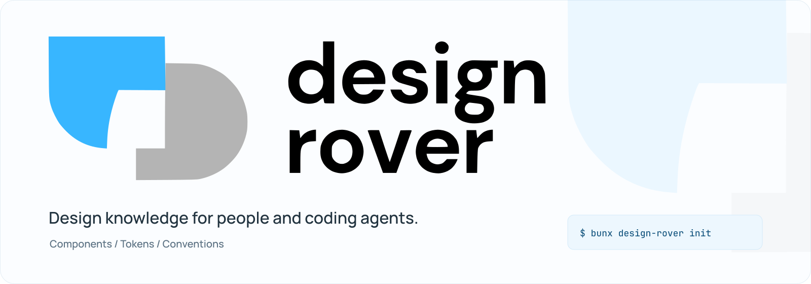

# Design Rover

<picture>
  <source media="(prefers-color-scheme: dark)" srcset="assets/brand/readme-banner-dark.svg">
  
</picture>

[](https://github.com/nisargkavi/design-rover/actions/workflows/publish-cli.yml)
[](https://www.npmjs.com/package/design-rover)
[](LICENSE)

**Give coding agents design knowledge from your existing codebase.**

Design Rover is a local CLI for React/TypeScript projects. It records component APIs, scoped CSS tokens and UI conventions in a repository model, lets you review inferred rules, and makes that knowledge available through CLI queries, generated instructions and MCP.

Use it to find a component before rebuilding it, check the API before calling it, and review design-system changes alongside your code. It analyzes source; it does not redesign screens or rewrite application files.

## Start in five minutes

Requires Bun and Node >=20.19.0. Run these commands from the project you want to analyze; no global installation is needed.

```sh
bunx design-rover init
bunx design-rover diff
```

Review the proposals, then replace `<id>` with a record or change ID from the output:

```sh
bunx design-rover approve <id>
bunx design-rover generate
bunx design-rover check
```

`init` writes `.design-rover/` and leaves inferred knowledge pending. Use `approve` without an ID only when you want to approve all reviewed proposals. After editing UI code, run `diff` and `sync` to review new observations. `sync --yes` skips the prompt; approving pending rules is a separate explicit choice.

For example, if your Button already offers a large size, a custom padding override can produce a finding that points to that API. For a resolved prop, a change from optional to required appears in the model diff. Findings include source evidence so you can decide whether they apply.

Approve a component ID to establish a reviewed API contract. Confirmed changes or removal then fail the default CI gate; observed inventory stays informational. Routine `sync` preserves approved or human-annotated removals until you explicitly accept their change ID. See [review and checking behavior](docs/usage.md#check-changes-and-adopt-gradually).

## Use with an AI agent

Check freshness, then retrieve context for the task and path you are editing:

```sh
bunx design-rover status --json
bunx design-rover context "add a billing form" --path app/billing/page.tsx --max-chars 12000 --json
```

Use a path that exists in your project. `context` reads the saved model without scanning source. Refresh observations with `sync` when needed; do not treat a saved context packet as proof that the code is current.

Approved rules and observed APIs are included by default. Pending inferences require `--include-pending`. The result reports omitted records and decisions when a limit is reached: narrow the request or increase the budget rather than silently ignoring a constraint.

`generate` writes AGENTS.md, CLAUDE.md, a Cursor rule and an Agent Skill. These are projections; `.design-rover/` remains the canonical model. Agents can also retrieve the same task context through MCP `get_context`.

See [agent and MCP usage](docs/usage.md#ai-agents-and-mcp) for the full workflow.

## What it understands

| Area | Current support |
| --- | --- |
| Components | JSX, CVA variants, local/imported prop types and local barrel exports |
| Tokens | CSS custom properties with selector/media scope and importance; basic Tailwind configuration |
| Decisions | Reviewable conventions, patterns, design intent and scoped exceptions |
| Changes | API/token drift, stale generated guidance, basic usage findings and baselines |
| Retrieval | Task/path filtering, whole records, source references and explicit omissions |

Type resolution is limited to scanned local modules and supported static forms. External package declarations, complex TypeScript and dynamic styling can remain unresolved; records expose resolution issues. CSS class contracts such as `.btn`/`.field` variants are not represented as React component APIs. A clean check does not prove complete design-system conformance, visual quality, accessibility or Figma parity.

The local Studio is a read-only viewer. Figma/Storybook support is experimental JSON evidence import, and the hosted snapshot service is an in-memory prototype. See [supported behavior and limits](docs/usage.md#supported-behavior-and-limits).

## Keep knowledge reviewable

For a shared team workflow, commit reviewed canonical records under `.design-rover/` so decisions can be reviewed with code, while keeping caches and generated snapshots local. A local-only setup can ignore all tool artifacts instead. Choose deliberately rather than adding every generated file to Git.

See [Git tracking recommendations](docs/usage.md#git-tracking) before adding the model to version control. Never commit credentials or unreviewed private metadata.

## Develop and contribute

Use Bun 1.4.4 in this repository:

```sh
bun install --frozen-lockfile
bun run typecheck
bun run test
bun run test:scripts
bun run pack:cli
bun run smoke:cli
```

Read the [contribution guide](CONTRIBUTING.md) before opening an issue or pull request. See [development and releases](docs/development.md) for source commands, package validation and publishing.

[npm package](https://www.npmjs.com/package/design-rover) · [GitHub Releases](https://github.com/nisargkavi/design-rover/releases) · [0.3.4 release notes](docs/releases/v0.3.4.md) · [MIT license](LICENSE)
