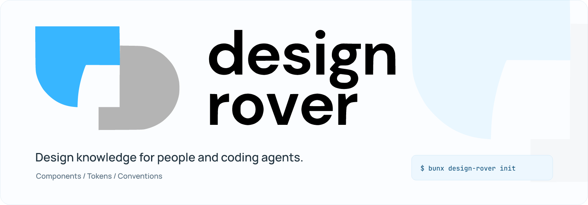

# Design Rover

[](https://github.com/nisargkavi/design-rover)

Design knowledge from your existing React/TypeScript codebase, available to people and coding agents.

Run from the project you want to analyze. Requires Bun and Node >=20.19.0; no global installation is needed.

```sh
bunx design-rover init
bunx design-rover diff
```

Review the output, approve the records you want with `bunx design-rover approve <id>`, then generate instructions and run checks:

```sh
bunx design-rover generate
bunx design-rover check
bunx design-rover context "update a form" --path src/App.tsx --max-chars 12000 --json
```

Use a path that exists in your project. Canonical knowledge lives in `.design-rover/`; generated agent instructions are projections. `context` and MCP `get_context` check source freshness by default and return saved records with review/refresh actions when observations are stale. Run the actions from the returned repository directory: review the diff, then apply observed updates explicitly with `sync --yes`. This leaves pending approvals unchanged. Resolve decisions that need explicit approval or rejection, then request context again. Retrieval does not apply updates or approve pending rules.

Use `--no-check-freshness` for a saved snapshot without a source scan (MCP: `checkFreshness: false`). Pending approvals and outdated guidance are reported separately from source drift. Retrieval reports whole records omitted by its limits; freshness covers supported observations at the time of the check.

Component APIs resolve through supported local imports and barrel exports. Unresolved types are reported instead of presented as complete. CSS class contracts such as `.btn`/`.field` variants are outside the React component model. Analysis runs locally and does not upload application source; a clean check does not prove complete design-system conformance, visual quality or accessibility.

[Full documentation](https://github.com/nisargkavi/design-rover#readme) · [CLI and agent usage](https://github.com/nisargkavi/design-rover/blob/main/docs/usage.md) · [Releases](https://github.com/nisargkavi/design-rover/releases)
